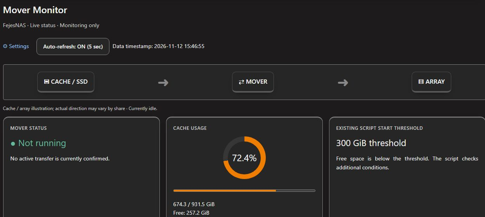
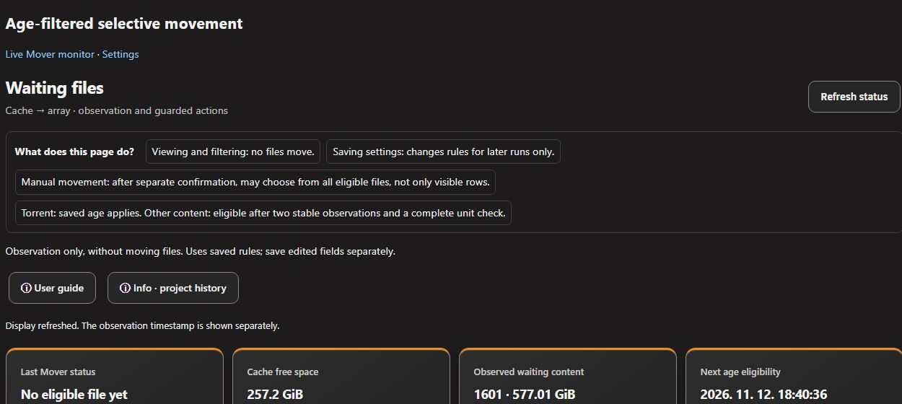
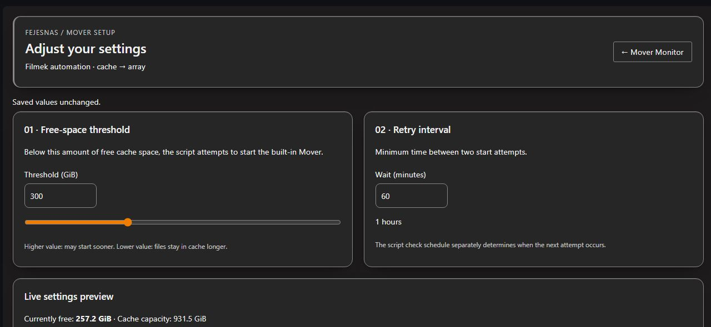
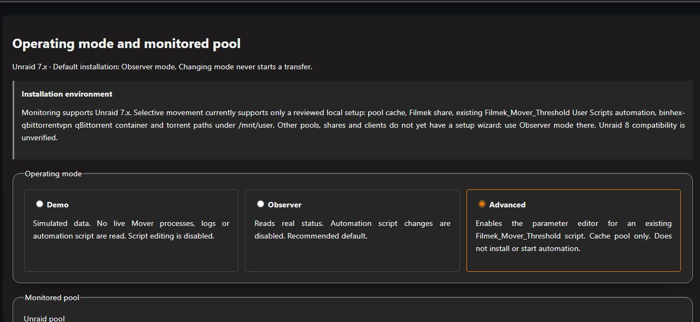

# Fejes Mover Monitor

**Release 2026.11.18.2 · Unraid 7.x · Magyar / English (US) / Deutsch**

Monitor cache capacity and optionally move completed downloads to the array, then resume seeding, in the documented reviewed setup. Completed-download mode uses configurable cache fill start/stop limits (default 75% / 65%).

[Release](https://github.com/fejesgabortorrent-dot/unraid-fejes-mover-monitor/releases/tag/v2026.11.18.2) · [Current acceptance and limits](docs/ACCEPTANCE-20261118.md) · [Movement guide](docs/SELECTIVE-MOVEMENT.md) · [Reboot recovery](docs/REBOOT-RECOVERY.md)

Version 18.1 adds persistent private run events, readable phase history in the
movement page, terminal hangup protection, and explicit fully verified recovery
of a restored complete unit after coordinator loss. A missing completion record
remains an inspection condition; it is never silently converted into success.

## Completed-download mode

Explicitly enable this mode in Advanced movement settings after reviewing the
scope and retaining a backup. It waits for full download completion, briefly
stops only the affected torrent, performs verified native movement and restores
seeding through the same user-share path. It does not wait for age or ratio.
Installation leaves this opt-in disabled on other systems.

At the upper cache fill limit, a drain cycle starts. Scheduled invocations move
one complete unit each until the lower limit is reached. Defaults are 75% start
and 65% stop; the already-started unit finishes even if it crosses the target.
Each invocation is capped at 32 GiB and 128 files. Larger units and incomplete
torrents remain in cache. Direct HDD downloading for torrents larger than cache
is not implemented. Upload pauses briefly during the affected unit's move.
All maintenance, open-file, namespace, cooldown and inspection guards remain.

Fresh VM peer transfer, hybrid cache/array placement and installed-scheduler
movement were verified on Unraid 7.3.4. Physical power-loss and mid-native-I/O
termination recovery remain uncertified. See the dated acceptance document.

## Magyar

Mover-állapot, cache-foglaltság és várakozási okok egy felületen. Az alapértelmezett Observer mód csak megfigyel. A Haladó mód a dokumentált környezetben korhatáros, torrentenként védett natív mozgatást kínál, céloldali SHA-256- és metaadat-ellenőrzéssel. A telepítés nem indít mozgatást és nem hoz létre ütemezést.

## English

The default Observer mode reads status. Advanced mode adds optional native movement with torrent age, open-file and maintenance guards, whole-unit selection, and destination checksum/metadata verification. Waiting dates describe age eligibility, not a promised transfer start or completion.

## Deutsch

Observer ist der Standard und zeigt den Status an. Der optionale Advanced-Modus bietet im dokumentierten Umfeld altersabhängiges natives Verschieben mit Torrent-, Datei- und Wartungsschutz sowie SHA-256- und Metadatenprüfung. Die Installation startet keinen Transfer und erstellt keinen Zeitplan.

## Current gallery

English interface crops captured on 2026-11-12. These are actual interface views with point-in-time status and saved settings; values are examples, not recommended defaults or transfer-performance evidence. Private file lists and logs are excluded. The surrounding Unraid theme can differ.

### Mover activity and cache capacity



### Waiting content and guarded actions



### Existing automation settings



### Demo, Observer and Advanced modes



## Legacy age-filtered mode features

- Mover process status, cache capacity, open-file observations and recent Mover-related logs.
- Hungarian, US English and German interfaces; appearance palettes, raised/flat cards, keyboard navigation and help.
- Waiting-file search, status/video filters, sorting, age eligibility and concrete blocking reasons.
- Independent root files are not grouped solely by arrival time; folder, sidecar and torrent relationships remain protected.
- Torrent age options: 1 / 7 / 14 / 30 days. Other content requires two stable observations and a complete-unit check.
- A nonzero ratio target is mandatory for every owning torrent; low or unknown ratios defer the unit.
- Whole eligible units are considered under the configured 16 / 32 / 64 / 128 GiB batch limit; oversized units wait.
- Fresh backup, parity, scrub, mount, integrity, open-file and cooldown checks; unavailable torrent information safely defers movement.
- Bounded blocker details keep large waiting lists manageable.
- Authenticated optional manual actions and backed-up integration with reviewed existing automation.

## Compatibility and limits

Monitoring targets Unraid 7.x, minimum 7.0.0, one configured pool at a time. Unmounted pools remain unavailable.

Selective movement is limited to the reviewed setup: a pool named `cache`, `Filmek` share configured cache-to-array, existing `Filmek_Mover_Threshold` User Scripts automation, `binhex-qbittorrentvpn`, and torrent paths through `/mnt/user`. Other configurations should use Observer until their setup is validated. Unraid 8 and a Docker edition are future work.

Installation and mode changes create no schedule and start no transfer. A native multi-file batch is not atomic across crashes. Files exceeding the saved byte limit remain in cache.

After reboot, missing btrfs scrub history can block movement until a fresh real scrub completes successfully. Follow [reboot recovery](docs/REBOOT-RECOVERY.md); unattended reboot-to-ready is not claimed.

## Previous stable validation

Stable 2026.11.14.3 passed GitHub Actions run #137, including the isolated test suite and release publication. On the disposable Unraid 7.3.4 VM, the plugin installed and reported the same version; saving a 30-minute managed schedule succeeded, the read-only probe performed no movement, and the schedule was disabled after acceptance. The previous stable build's isolated guarded movement and peer-transfer evidence remains documented below.

This does not certify public tracker credit, production VPN behavior, physical power-loss recovery or broad hardware compatibility. See [dated evidence](docs/ACCEPTANCE-20261112.md).

## Installation

Read the [movement guide](docs/SELECTIVE-MOVEMENT.md) and retain a backup. Find **Fejes Mover Monitor** in Community Applications, or use **Plugins → Install Plugin**:

```
https://raw.githubusercontent.com/fejesgabortorrent-dot/unraid-fejes-mover-monitor/v2026.11.18.2/fejes.mover.monitor.plg
```

See [release assets](https://github.com/fejesgabortorrent-dot/unraid-fejes-mover-monitor/releases/tag/v2026.11.18.2) for the manifest, source ZIP and SHA-256 checksum files.

Open **Tools → Mover figyelő** or the dashboard card. The self-contained manifest supplies the runtime. Start in Observer mode and review the compatibility limits before Advanced mode.

## Removal and support

Remove the plugin through Unraid's Plugins page. Configuration, evidence, backups and separately wired automation are retained. To disable that automation too, follow the movement guide's restoration procedure first.

[GitHub Issues](https://github.com/fejesgabortorrent-dot/unraid-fejes-mover-monitor/issues): include Unraid version and reproduction steps. Redact filenames; do not post credentials or full private logs. No telemetry or private NAS files are distributed with this repository.

## Build

```sh
python3 tools/build.py
python3 tools/check.py
sha256sum -c SHA256SUMS
```

## Optional support

Free and open source under the MIT license. [Support development via PayPal](https://paypal.me/FejesG): coffee 2 EUR, beer 5 EUR, pizza 10 EUR or another amount. Amounts stay in EUR in every interface language. Support is voluntary and unlocks no features.

A támogatás önkéntes, minden funkció ingyenes. Die Unterstützung ist freiwillig; alle Funktionen bleiben kostenlos.
