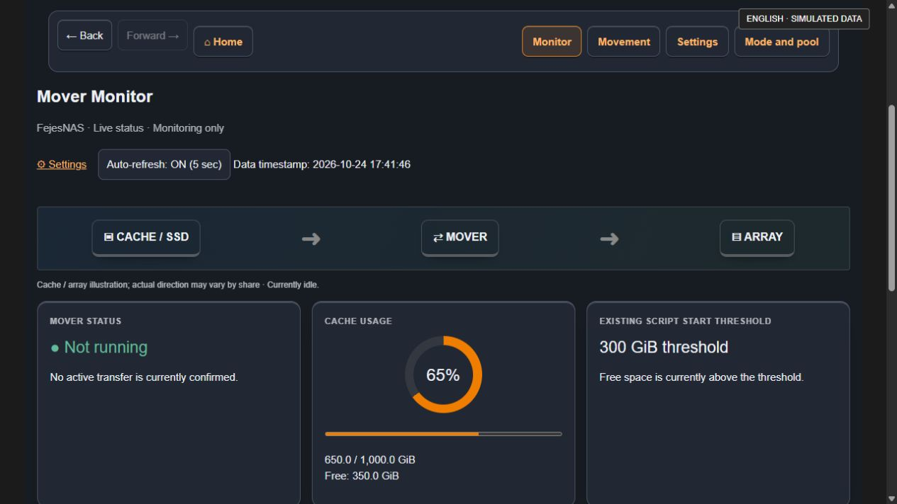
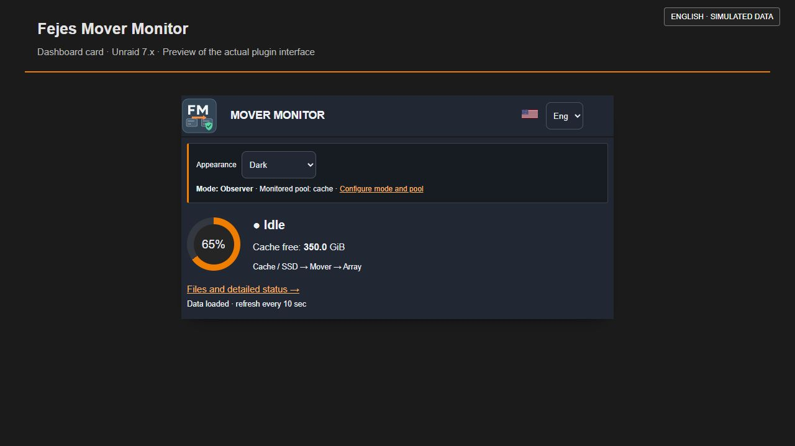
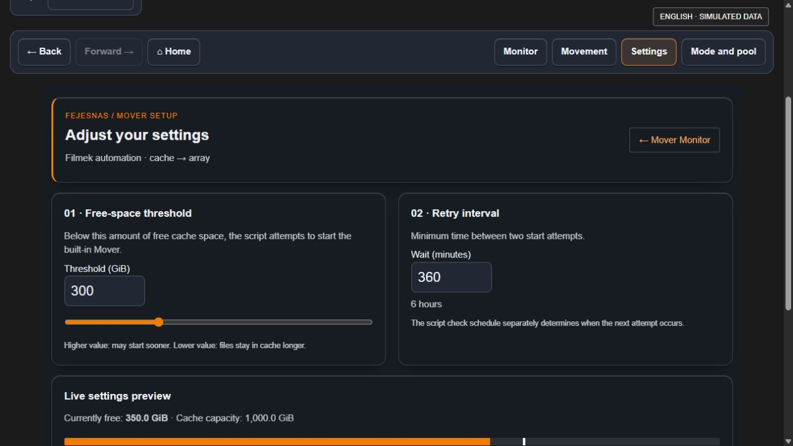
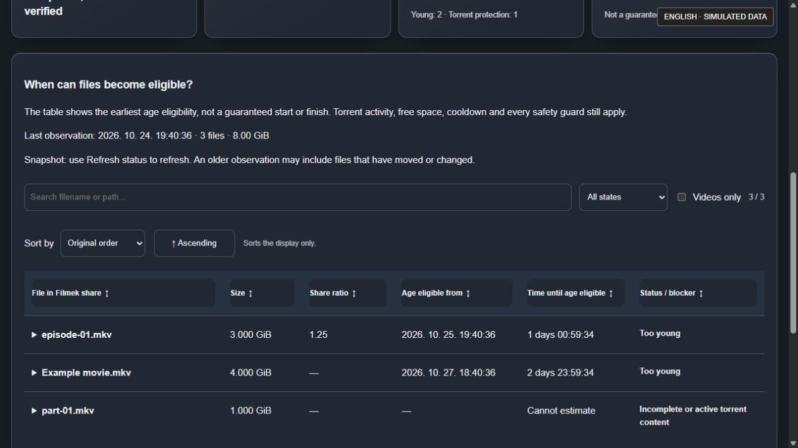

# Fejes Mover Monitor

## 🇭🇺 Magyar · 🇺🇸 English (US) · 🇩🇪 Deutsch

**Three interface languages · Három kezelőfelületi nyelv · Drei Oberflächensprachen**

[](https://paypal.me/FejesG)

*Önkéntes támogatás · Optional support · Freiwillige Unterstützung*

Mover dashboard and file monitor for Unraid 7.x with Hungarian, US English and German interfaces.

**2026.10.25.2 · Release Candidate 1 (RC1) · Unraid 7.x**

[Current manifest](fejes.mover.monitor.plg) · [Selective movement and recovery](docs/SELECTIVE-MOVEMENT.md) · [Evidence and limits](docs/RELEASE-STATUS.md)

Initial mode is **Observer**. Choose **Demo / Observer / Advanced** at `/Tools/FejesMoverSetup`. Installation and mode changes never start movement or install a schedule. Advanced/cache mode includes authenticated, opt-in age-filtered movement for the existing `Filmek` share and reviewed threshold automation. The app is listed in the owner's Community Applications search; listing is not broad hardware certification.

**Magyar:** Az új szelektív mozgató kihagyja a túl fiatal, félkész, aktív, megnyitott vagy megváltozott fájlokat. A korhatár 1 / 7 / 14 / 30 nap; a cache-ben igazolt első megfigyelés is számít. A natív Unraid-mozgatót használja, a célon SHA-256-ot és metaadatokat ellenőriz. Az automatikus bekötés külön, mentéssel történik; telepítéskor nem változik a meglévő ütemezés.

Raised / flat cards, consistent Back / Forward / Home navigation, and bidirectional queue sorting are available in Hungarian, English and German. Display preferences and sorting never alter movement rules or schedules.

## Screenshots / Képernyőképek

**English interface previews with simulated data — not a live NAS or transfer-test evidence.** Rendered from the current plugin pages in a standalone dark preview wrapper; the surrounding Unraid theme can differ. The monitor footer still contains some Hungarian text. Current test evidence and limitations are recorded in the release status.

**Helyi demó, szimulált adatokkal.** A képek nem az élő NAS-ról készültek.

### Mover Monitor / Figyelő



### Dashboard card / Dashboard-kártya



### Settings / Beállítások



### Selective movement / Szelektív mozgatás



To refresh the gallery after a design change, run `tools/export_store_preview.py` with PHP and Bash on PATH, serve the exported HTML on loopback, and capture the pages in a browser. Inspect every image for private information and rendering errors. Use new dated filenames and update both this gallery and the `<Screenshot>` entries in `plugins/fejes-mover-monitor.xml`; Community Applications may take time to refresh its index. Screenshot-only updates do not require a plugin reinstall.

## Features

- Larger eligible files are selected first within each ratio-priority group, so small sidecar files do not consume every file slot before media. The 8-file and configured byte caps still apply; protected files remain excluded. This execution order is separate from table sorting.

- Optional share-ratio priority (0 disables it, target up to 100): already eligible files whose torrents meet the target go first. Low or unknown ratios never withhold a file. Shared content uses the lowest known owner ratio; missing owner values remain unknown. Ratio is not a tracker seed-time exemption and never bypasses age, activity or safety guards.
- Explicit batch-size selection for larger media: 16 / 32 / 64 / 128 GiB, still at most 8 files. Existing installations keep 16 GiB until an authenticated settings save. No schedule or live configuration is changed by installation.

- Appearance selector in the mode banner: Follow Unraid (default), Light or Dark. Explicit palettes affect plugin surfaces only; the Unraid shell stays unchanged. The browser remembers the selection locally; blocked browser storage falls back to Follow Unraid.

- Selective page organized around summary cards and the file queue, with local filename/path search, status and video-only filters, expandable full paths, folded settings and a separate confirmed manual-action section. Filters only change the display, never the execution scope.

- Private waiting table on the selective page: per-file size, earliest age eligibility, live countdown and blockers. Use Read-only check for a fresh snapshot; ordinary page refreshes do not scan storage or query torrents. Dates are age eligibility only, not guaranteed movement start/finish times. Active/incomplete/open content and files above the fixed batch limit have no promised date. Cache and torrent activity can change after observation.

- Dashboard tile with Mover process status and cache usage.
- Tools page showing open files belonging to the Mover process tree.
- Recent Mover-related syslog lines, escaped before display.
- Polling only while the page is visible, with timeouts and stale-data notices.
- Optional settings page for an existing `Filmek_Mover_Threshold` User Scripts automation.
- Optional age-filtered native movement, with exact single-file input and no global Mover invocation.
- Per-content torrent exclusions, fresh maintenance/open-file checks, SHA-256 and metadata verification.
- Authenticated manual start and explicit, backed-up integration with an existing schedule.

## Requirements and limits

- Unraid 7.0+ and its bundled PHP 8; the original local version was used on Unraid 7.3.3.
- Observe one configured Unraid pool at a time using mode/pool setup. The default is `cache`; unmounted pools remain unavailable. The optional legacy script editor remains cache-only.
- Use the 🌐 language selector on the dashboard, monitor or settings page: **Magyar / English (US) / Deutsch**. The choice is stored in a browser cookie for one year and shared by these pages. Hungarian is the default and the fallback for invalid selections. Switching language reloads the page and discards unsaved form edits; it never submits settings. Unraid menu names remain the static labels Mover Monitor / Mover Settings. Logs, filenames and existing script contents retain their original text.
- Mover activity is inferred from `/var/run/mover.pid` and `/proc`. Custom Mover implementations may not be detected.
- File positions are observations, not verified transfer progress. No transfer ETA or total progress is claimed.
- The cache-to-array diagram is illustrative. Actual movement direction is controlled by each share's Unraid settings.
- The optional threshold panel requires the pre-existing script at `/boot/config/plugins/user.scripts/scripts/Filmek_Mover_Threshold/script`. It is not distributed here. Without it, monitoring still works and settings explain that the optional automation is unavailable.
- The settings panel changes only `KUSZOB_GIB` and `UJRA_PROBALKOZAS_MP`, after CSRF, version, range, lock and shell-syntax checks. It saves a backup first. The legacy UI interprets `UJRA_PROBALKOZAS_MP` as minutes; check your script's semantics before using this panel with a different script.
- Installation never creates a schedule or starts movement. The optional selective executor has backup/parity/scrub/mount/integrity/cooldown guards. It supports **cache/Filmek → Array** with user-share torrent bindings. Observer monitoring remains available for other configured pools.
- Selection uses the newest of mtime, verified first observation and torrent completion. Old-looking files may need the full new observation window. A batch is limited to 8 files and a configurable 16 / 32 / 64 / 128 GiB (default 16 GiB); files larger than the selected limit are skipped.

## RC1 installation

See the [RC1 release notes](docs/RC1.md), then read [the selective movement guide](docs/SELECTIVE-MOVEMENT.md), verify checksums, and keep a backup. Owner acceptance on Unraid 7.3.3 used self-created files outside Emby. A bounded owner run moved 8 production-content files (8.929 GiB) with verified checksums/metadata and unchanged torrent paths/completeness/seed states; actual peer upload, tracker credit and live NAS reboot persistence remain unverified.

In Unraid, open **Plugins → Install Plugin**, then enter:

```
https://raw.githubusercontent.com/fejesgabortorrent-dot/unraid-fejes-mover-monitor/main/fejes.mover.monitor.plg
```

The manifest contains the runtime pages. It does not rely on files from the author's NAS. The installer checks PHP syntax before activating them.

Open **Tools → Mover figyelő** or the dashboard tile. Plugin updates use the manifest URL above.

## Uninstall

Remove `fejes.mover.monitor` through Unraid's Plugins page. Owned runtime pages are removed; settings, inventories, helpers, external wiring and backups are retained. UI uninstall does **not** disable separately wired automation. Follow the selective guide's restoration procedure first if you also want that disabled.

## Privacy and support

No telemetry, credentials, server logs or user files are shipped in this repository. Live file paths and syslog excerpts are shown only inside the authenticated Unraid interface. Redact personal filenames before posting screenshots.

Report problems at [GitHub Issues](https://github.com/fejesgabortorrent-dot/unraid-fejes-mover-monitor/issues). Include your Unraid version, pool name and reproduction steps. Do not attach credentials or full private logs.

## Build

```
python3 tools/build.py
python3 tools/check.py
sha256sum -c SHA256SUMS
```

This rebuilds the self-contained `.plg` manifest and checksums from `src/`. Before publishing changes, run PHP lint on all page files, validate the XML, and test install/update/remove on an appropriate Unraid system.

The verified owner baseline is stored as self-contained trilingual PHP source. The compiler preserves those pages verbatim instead of wrapping their language branches a second time. Tests execute the resulting pages in all three languages.

## License

MIT. Copyright 2026 FejesNAS contributors.

## Release readiness

See [release status and remaining acceptance tests](docs/RELEASE-STATUS.md). Earlier packaging and testing notes describe the previous archive-based prototype; this candidate uses the self-contained manifest and `src/` files.

## Optional support

Fejes Mover Monitor is free and open source. If you find it useful, you can [support FejesNAS development via PayPal](https://paypal.me/FejesG). Support is voluntary and does not unlock features or guarantee support or development timelines.

A Fejes Mover Monitor ingyenes és nyílt forráskódú. Ha hasznosnak találod, [támogathatod a FejesNAS fejlesztéseit PayPalon](https://paypal.me/FejesG). A támogatás önkéntes.
