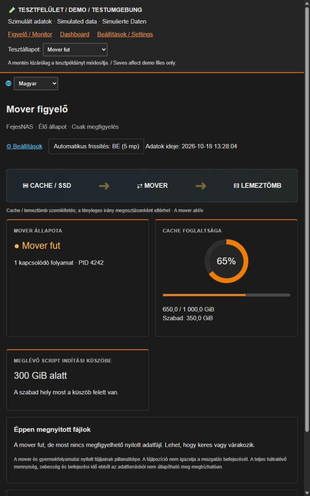
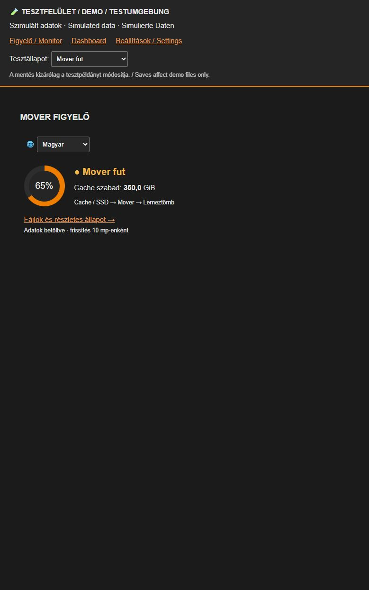
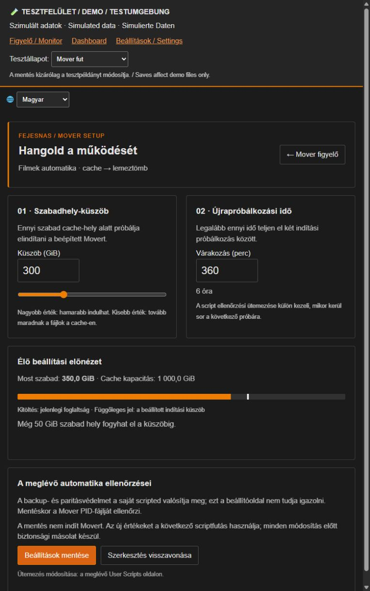

# Fejes Mover Monitor

## 🇭🇺 Magyar · 🇺🇸 English (US) · 🇩🇪 Deutsch

**Three interface languages · Három kezelőfelületi nyelv · Drei Oberflächensprachen**

[](https://paypal.me/FejesG)

*Önkéntes támogatás · Optional support · Freiwillige Unterstützung*

Mover dashboard and file monitor for Unraid 7.x with Hungarian, US English and German interfaces.

**Experimental beta 0.1.0-beta.1 · Unraid 7.x · Not production-validated.**

[Download the beta](https://github.com/fejesgabortorrent-dot/unraid-fejes-mover-monitor/releases/tag/v0.1.0-beta.1) · [Installation, checksums and removal/recovery](docs/BETA-INSTALL.md)

Initial mode is **Observer**. Choose **Demo / Observer / Advanced** at `/Tools/FejesMoverSetup`. Advanced editing requires explicit acknowledgment and an existing cache-only automation script. No mode change starts Mover. Live Unraid installation and reboot acceptance testing remain outstanding. Not submitted to Community Applications.

## Screenshots / Képernyőképek

**Local browser demo with simulated data — not a live NAS.** These images show the actual compiled plugin pages in the isolated demo wrapper. Actual Unraid dashboard integration still requires acceptance testing.

**Helyi demó, szimulált adatokkal.** A képek nem az élő NAS-ról készültek.

### Mover Monitor / Figyelő



### Dashboard card / Dashboard-kártya



### Settings / Beállítások



## Features

- Dashboard tile with Mover process status and cache usage.
- Tools page showing open files belonging to the Mover process tree.
- Recent Mover-related syslog lines, escaped before display.
- Polling only while the page is visible, with timeouts and stale-data notices.
- Optional settings page for an existing `Filmek_Mover_Threshold` User Scripts automation.

## Requirements and limits

- Unraid 7.0+ and its bundled PHP 8; the original local version was used on Unraid 7.3.3.
- Observe one configured Unraid pool at a time using mode/pool setup. The default is `cache`; unmounted pools remain unavailable. The optional legacy script editor remains cache-only.
- Use the 🌐 language selector on the dashboard, monitor or settings page: **Magyar / English (US) / Deutsch**. The choice is stored in a browser cookie for one year and shared by these pages. Hungarian is the default and the fallback for invalid selections. Switching language reloads the page and discards unsaved form edits; it never submits settings. Unraid menu names remain the static labels Mover Monitor / Mover Settings. Logs, filenames and existing script contents retain their original text.
- Mover activity is inferred from `/var/run/mover.pid` and `/proc`. Custom Mover implementations may not be detected.
- File positions are observations, not verified transfer progress. No transfer ETA or total progress is claimed.
- The cache-to-array diagram is illustrative. Actual movement direction is controlled by each share's Unraid settings.
- The optional threshold panel requires the pre-existing script at `/boot/config/plugins/user.scripts/scripts/Filmek_Mover_Threshold/script`. It is not distributed here. Without it, monitoring still works and settings explain that the optional automation is unavailable.
- The settings panel changes only `KUSZOB_GIB` and `UJRA_PROBALKOZAS_MP`, after CSRF, version, range, lock and shell-syntax checks. It saves a backup first. The legacy UI interprets `UJRA_PROBALKOZAS_MP` as minutes; check your script's semantics before using this panel with a different script.
- The plugin does not install a scheduler, start Mover, move files or provide backup/parity guards itself. Those remain the responsibility of Unraid and any existing automation.

## Experimental beta installation

Use a test Unraid 7.x system. Read [the installation and recovery guide](docs/BETA-INSTALL.md) and verify the release checksums first. This beta has not been accepted on live Unraid.

In Unraid, open **Plugins → Install Plugin**, then enter:

```
https://raw.githubusercontent.com/fejesgabortorrent-dot/unraid-fejes-mover-monitor/v0.1.0-beta.1/fejes.mover.monitor.plg
```

The manifest contains the runtime pages. It does not rely on files from the author's NAS. The installer checks PHP syntax before activating them.

Open **Tools → Mover figyelő** or the dashboard tile. Plugin updates use the manifest URL above.

## Uninstall

Remove `fejes.mover.monitor` through Unraid's Plugins page. Its three runtime pages are removed. Existing local automation scripts and `/boot/config/plugins/fejes.mover.monitor/backups` are preserved.

## Privacy and support

No telemetry, credentials, server logs or user files are shipped in this repository. Live file paths and syslog excerpts are shown only inside the authenticated Unraid interface. Redact personal filenames before posting screenshots.

Report problems at [GitHub Issues](https://github.com/fejesgabortorrent-dot/unraid-fejes-mover-monitor/issues). Include your Unraid version, pool name and reproduction steps. Do not attach credentials or full private logs.

## Build

```
python3 tools/build.py
python3 tools/check.py
sha256sum -c SHA256SUMS
```

This rebuilds the self-contained `.plg` manifest and checksums from `src/`. Before publishing changes, run PHP lint on all page files, validate the XML, and test install/update/remove on an appropriate Unraid system.

## License

MIT. Copyright 2026 FejesNAS contributors.

## Release readiness

See [release status and remaining acceptance tests](docs/RELEASE-STATUS.md). Earlier packaging and testing notes describe the previous archive-based prototype; this candidate uses the self-contained manifest and `src/` files.

## Optional support

Fejes Mover Monitor is free and open source. If you find it useful, you can [support FejesNAS development via PayPal](https://paypal.me/FejesG). Support is voluntary and does not unlock features or guarantee support or development timelines.

A Fejes Mover Monitor ingyenes és nyílt forráskódú. Ha hasznosnak találod, [támogathatod a FejesNAS fejlesztéseit PayPalon](https://paypal.me/FejesG). A támogatás önkéntes.


## Integrated protection candidate / Összevont védelmi próbaverzió

Candidate `2026.10.19.92` combines the current mode/pool UI and flag navigation
with torrent and scheduled File Integrity diagnostics. Open Tools / FejesMover
védelem from the monitor. Protection diagnostics, monitor, settings and mode setup support HU / US English / German.
Demo diagnostics use synthetic data. Observer diagnostics read state only.
Integrity schedule wiring requires Advanced mode, a mounted cache and separate
consent. Installation never wires schedules or starts Mover/hashing.

Removal deletes the owned WebGUI files but retains configuration, helpers,
backups and separately configured external schedule integrations. This avoids
breaking existing File Integrity jobs. Explicit restoration commands and the
global torrent gate limitations are described in
[the protection guide](docs/TORRENT-INTEGRITY-HU.md).

[Owner-only GitHub download counter](docs/GITHUB-DOWNLOADS-HU.md) is included as
a separate tool, never installed or scheduled by the plugin. No public NAS
receiver or telemetry endpoint is enabled.

The FM icon means **Fejes Mover**: two drives, an orange transfer arrow and a
green protection shield. PNG is used for the catalog; SVG remains editable.
The Community Applications listing has not been submitted.

### Read-only start preview / Indítási próba
Use the orange **Dry run – no file movement / Próba – nincs fájlmozgatás** button on the monitor or protection page. It reads a fresh snapshot of the reviewed launcher/share, cache threshold, torrents, Appdata backup marker, parity, Mover PID and retry timestamp. Green means clear, amber means wait, and unknown state prevents a ready result. Demo uses synthetic data; Observer also permits this read-only check. No launcher, schedule, settings or attempt timestamp is written, and no start lock is reserved. A preview is not a guarantee of a later real start.

The authenticated dry-run UI additionally shows up to 25 protected content basenames, identifying files/folders when their type is readable. No full paths are returned. Default status/CLI output remains redacted; private names require the explicit dry-run `--include-items` option and are never sent to GitHub.

Language selection persists across all five plugin views (including the Dashboard card). Native plugin page headings follow the same selection; Unraid navigation remains in the language configured in Unraid. Logs and private filenames are displayed as stored, never translated.

The installer requires PHP 8+ with ctype. Minimal environments without ctype are rejected before runtime activation. [Linux VM reboot acceptance](docs/LINUX-VM-ACCEPTANCE.md) documents successful guest-only install/reboot and removal/reboot checks; it does not replace genuine Unraid boot acceptance.
