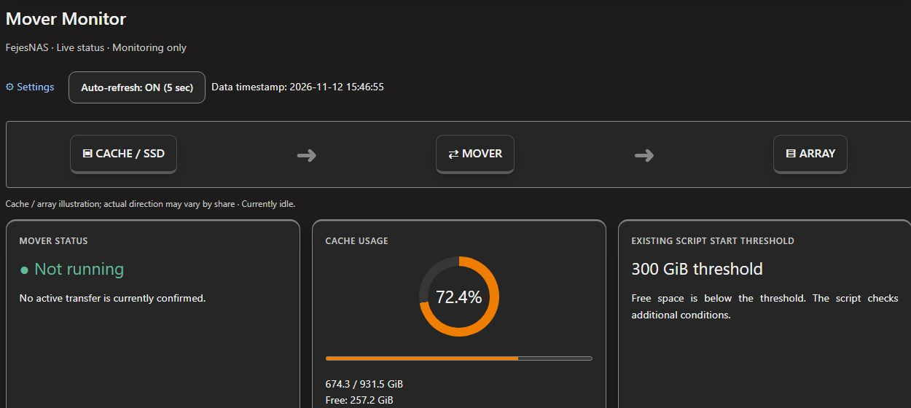
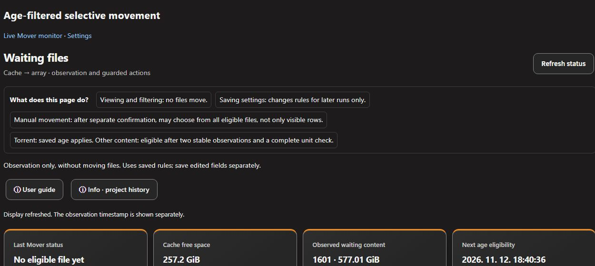
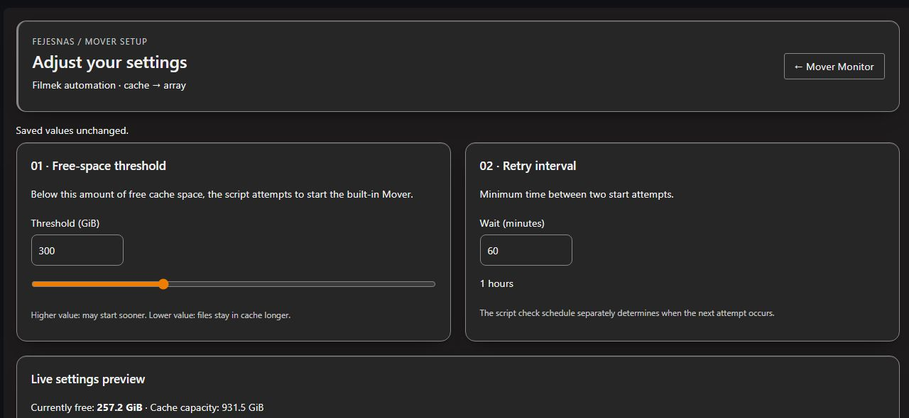
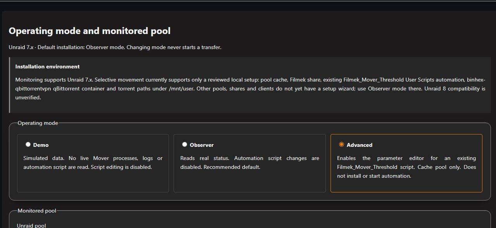

# Fejes Mover Monitor

**Candidate 2026.11.14.3 · Unraid 7.x · Magyar / English (US) / Deutsch**

Monitor Mover activity and cache capacity, inspect waiting content, and optionally use guarded age-filtered cache-to-array movement in the documented reviewed setup.

[Previous stable release](https://github.com/fejesgabortorrent-dot/unraid-fejes-mover-monitor/releases/tag/v2026.11.11.2) · [Acceptance evidence](docs/ACCEPTANCE-20261112.md) · [Movement guide](docs/SELECTIVE-MOVEMENT.md) · [Reboot recovery](docs/REBOOT-RECOVERY.md)

## Magyar

Mover-állapot, cache-foglaltság és várakozási okok egy felületen. Az alapértelmezett Observer mód csak megfigyel. A Haladó mód a dokumentált környezetben korhatáros, torrentenként védett natív mozgatást kínál, céloldali SHA-256- és metaadat-ellenőrzéssel. A telepítés nem indít mozgatást és nem hoz létre ütemezést.

## English

The default Observer mode reads status. Advanced mode adds optional native movement with torrent age, open-file and maintenance guards, whole-unit selection, and destination checksum/metadata verification. Waiting dates describe age eligibility, not a promised transfer start or completion.

## Deutsch

Observer ist der Standard und zeigt den Status an. Der optionale Advanced-Modus bietet im dokumentierten Umfeld altersabhängiges natives Verschieben mit Torrent-, Datei- und Wartungsschutz sowie SHA-256- und Metadatenprüfung. Die Installation startet keinen Transfer und erstellt keinen Zeitplan.

## Current gallery

English interface crops captured on 2026-11-12. These are actual interface views with point-in-time status and saved settings; values are examples, not recommended defaults or transfer-performance evidence. Private file lists and logs are excluded. The surrounding Unraid theme can differ.

### Mover activity and cache capacity



### Waiting content and guarded actions



### Existing automation settings



### Demo, Observer and Advanced modes



## Features

- Mover process status, cache capacity, open-file observations and recent Mover-related logs.
- Hungarian, US English and German interfaces; appearance palettes, raised/flat cards, keyboard navigation and help.
- Waiting-file search, status/video filters, sorting, age eligibility and concrete blocking reasons.
- Independent root files are not grouped solely by arrival time; folder, sidecar and torrent relationships remain protected.
- Torrent age options: 1 / 7 / 14 / 30 days. Other content requires two stable observations and a complete-unit check.
- Optional ratio priority orders already eligible content; low or unknown ratios do not bypass or extend age protection.
- Larger eligible files first within each ratio-priority group; at most eight files and the configured 16 / 32 / 64 / 128 GiB batch limit.
- Fresh backup, parity, scrub, mount, integrity, open-file and cooldown checks; unavailable torrent information safely defers movement.
- Bounded blocker details keep large waiting lists manageable.
- Authenticated optional manual actions and backed-up integration with reviewed existing automation.

## Compatibility and limits

Monitoring targets Unraid 7.x, minimum 7.0.0, one configured pool at a time. Unmounted pools remain unavailable.

Selective movement is limited to the reviewed setup: a pool named `cache`, `Filmek` share configured cache-to-array, existing `Filmek_Mover_Threshold` User Scripts automation, `binhex-qbittorrentvpn`, and torrent paths through `/mnt/user`. Other configurations should use Observer until their setup is validated. Unraid 8 and a Docker edition are future work.

Installation and mode changes create no schedule and start no transfer. A native multi-file batch is not atomic across crashes. Files exceeding the saved byte limit remain in cache.

After reboot, missing btrfs scrub history can block movement until a fresh real scrub completes successfully. Follow [reboot recovery](docs/REBOOT-RECOVERY.md); unattended reboot-to-ready is not claimed.

## Validation

The previous stable build passed 183 automated cases, seven JavaScript suites, reproducible package/checksum checks and isolated lifecycle validation. The isolated Unraid VM passed full guarded movement of a genuinely aged 16 MiB torrent, source absence and destination SHA-256 verification, unchanged logical path, recheck and complete second-client download with matched SHA-256 and counted seeder upload. Candidate 2026.11.14.3 additionally fixes managed-scheduler cron refresh on the disposable Unraid 7.3.4 VM; candidate release remains gated on PR validation.

This does not certify public tracker credit, production VPN behavior, physical power-loss recovery or broad hardware compatibility. See [dated evidence](docs/ACCEPTANCE-20261112.md).

## Installation

Read the [movement guide](docs/SELECTIVE-MOVEMENT.md) and retain a backup. Find **Fejes Mover Monitor** in Community Applications, or use **Plugins → Install Plugin**:

```
https://raw.githubusercontent.com/fejesgabortorrent-dot/unraid-fejes-mover-monitor/v2026.11.14.3/fejes.mover.monitor.plg
```

The final manifest SHA-256 will be listed in the release assets after the main-branch validation workflow publishes this version.

Open **Tools → Mover figyelő** or the dashboard card. The self-contained manifest supplies the runtime. Start in Observer mode and review the compatibility limits before Advanced mode.

## Removal and support

Remove the plugin through Unraid's Plugins page. Configuration, evidence, backups and separately wired automation are retained. To disable that automation too, follow the movement guide's restoration procedure first.

[GitHub Issues](https://github.com/fejesgabortorrent-dot/unraid-fejes-mover-monitor/issues): include Unraid version and reproduction steps. Redact filenames; do not post credentials or full private logs. No telemetry or private NAS files are distributed with this repository.

## Build

```sh
python3 tools/build.py
python3 tools/check.py
sha256sum -c SHA256SUMS
```

## Optional support

Free and open source under the MIT license. [Support development via PayPal](https://paypal.me/FejesG): coffee 2 EUR, beer 5 EUR, pizza 10 EUR or another amount. Amounts stay in EUR in every interface language. Support is voluntary and unlocks no features.

A támogatás önkéntes, minden funkció ingyenes. Die Unterstützung ist freiwillig; alle Funktionen bleiben kostenlos.
